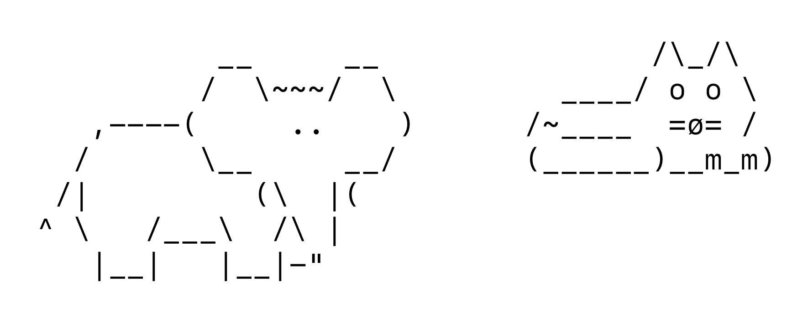
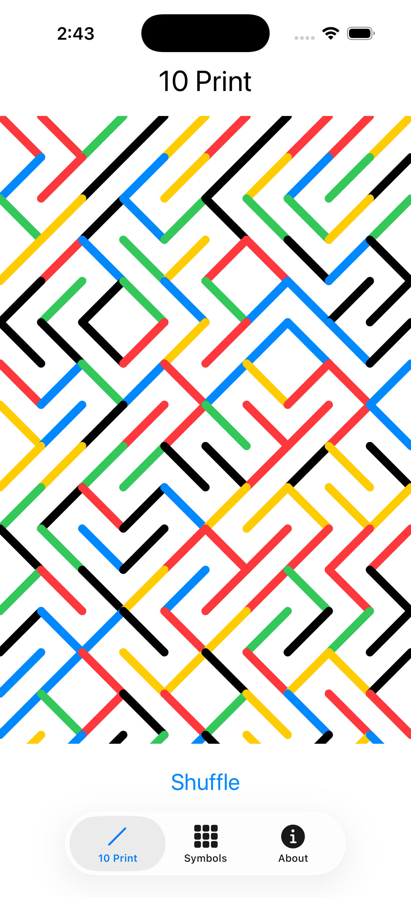
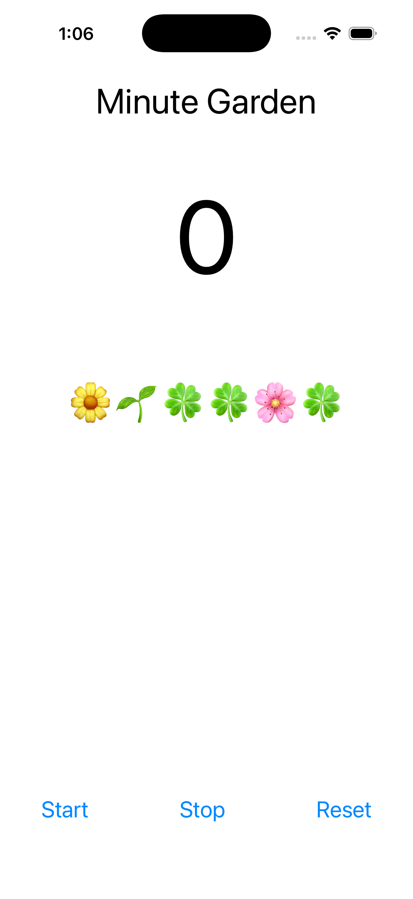
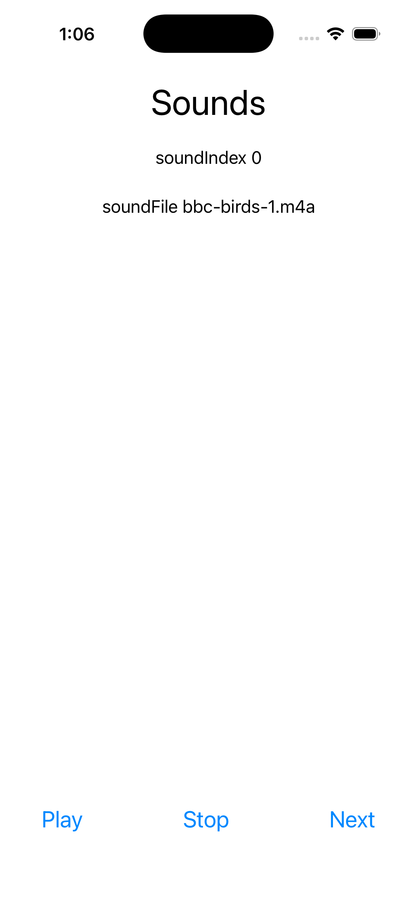
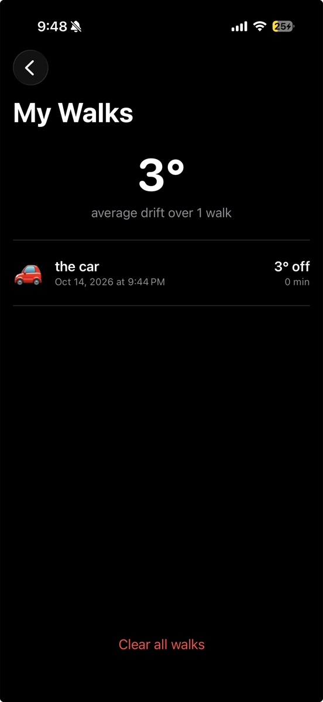
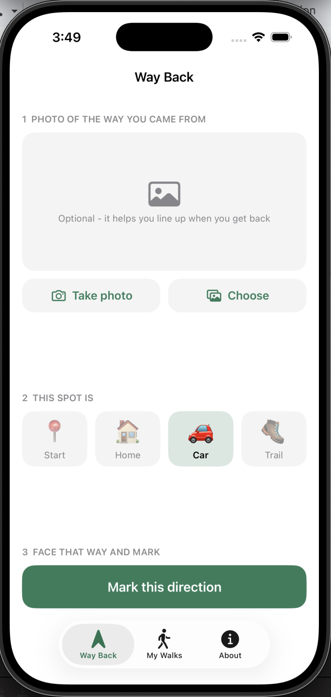

# molab-2026-itp-jackie

Class work for MoLab 2026 ITP — Jackie

- Midterm checklist
  - [x] weekly description of homework progress/challenges in your wiki page
  - [x] added jht9629-nyu as collab on your repo
  - [x] uploaded at least one photo in MoGallery TestFlight App
  - [x] able to build and run example apps own iPhone
  - [ ] installed Xcode 27
  - [ ] watched at least one WWDC video
  - [x] Upload profile photo to HOS-Lobby app

## Week01

- [MyPlayground.playground](Week01/MyPlayground.playground) — Swift fundamentals
  - `Hello Playground` — starter page
  - `generative random` — random emoji pattern generator (sample code from [molab-itp/01-Playground](https://github.com/molab-itp/01-Playground))

## Week02

Homework, Option 1: a playground that creates an image using ascii text.

- [02-Ascii-Play.playground](Week02/02-Ascii-Play.playground) — strings, arrays and ASCII art (sample code from [molab-itp/02-Ascii-Play](https://github.com/molab-itp/02-Ascii-Play))
  - `ascii image` — **my homework.** Loads two ascii animals from Resources, places them side by side, draws them into a `UIImage` and saves it as a png
  - `animals ascii` — load ASCII art text files from the playground Resources bundle
  - `cows ascii` — load the cows collection from a URL
  - `cows for loops` — iterate the cows with for loops
  - `cows grouped` — split the file into an array, one cow per entry
  - `cows sorted` — sort the cows by character count
  - `cows tuple` — sort with tuples to keep track of the original order
  - `inter weave` / `inter weave func` / `inter weave 3` — interleave lines of two or three ASCII animals

## Week03

Homework: a multi view SwiftUI app that displays an image composed of random elements,
using arrays and random numbers. First week as a real Xcode app project instead of a playground.

- [TenPrintTiles](Week03/TenPrintTiles) — four tab SwiftUI app, runs in the simulator
  - `ContentView` — the `TabView` that holds the four tabs (pattern from [molab-itp/03-About-Me](https://github.com/molab-itp/03-About-Me))
  - `TenPrintView` — the 10Print algorithm drawn with `Canvas`. Builds an array of random tiles, each with a random slash direction (`Bool.random()`) and a random color (`randomElement()`). Shuffle button rebuilds the array (based on [molab-itp/03-Canvas-Explore](https://github.com/molab-itp/03-Canvas-Explore) / `CanvasAnimView`)
  - `SymbolGridView` — same idea with random SF Symbols instead of lines (`Image(systemName:)` from [molab-itp/03-ImageUiDemo-1-symbols](https://github.com/molab-itp/03-ImageUiDemo-1-symbols))
  - `EmojiGridView` — **my own take.** A copy of `SymbolGridView` filled with my most used emojis, shuffled randomly. Emoji are text rather than symbols, so this one uses `Text(...)` instead of `Image(systemName:)`
  - `AboutView` — plain text describing what the other tabs do

## Week04

Homework: a SwiftUI app that incorporates time and/or audio playback, with at least two pages.

 

- [MinuteGarden](Week04/MinuteGarden) — **my homework.** A one minute timer. Press Start
  and a plant is added every 10 seconds while birds play underneath; a chime rings at zero
  - `Audio.swift` — the sound file names, the plant emoji, and `loadBundleAudio`, copied
    from [molab-itp/04-Audio-State-Demo](https://github.com/molab-itp/04-Audio-State-Demo) / `PlayAudioView`
  - `ContentView` — the `TabView` holding the three pages (same pattern as Week03)
  - `TimerView` — `Timer.publish(every: 1)` counts down from 60 in `.onReceive`. Every
    10th second adds a random plant to a string of emoji; zero stops the birds and plays
    the chime (countdown from `CountDownTimerView`)
  - `SoundsView` — Play / Stop / Next through the three sounds, essentially
    `PlayAudioView` with the names changed
  - `AboutView` — what the app is
  - Uses `@State` only — no shared model, no structs of my own, no grid math, so I can
    explain every line

## Week05

Homework: incorporate one of the class demos into the navigation app.

`[screenshots - need to run it on my phone]`

- [TurnBack](Week05/TurnBack) — **my homework.** A navigation app that runs on the
  gyroscope. Press Mark while facing the way you came in, and the arrow keeps pointing
  back that way however you turn
  - `BrowseView` — the list of pages, and where the sensor is started and stopped
    (from [molab-itp/05-Seismometer](https://github.com/molab-itp/05-Seismometer) / `SeismometerBrowser`)
  - `HeadingView` — **my own take.** `detector.yaw` says how far the phone has spun
    since the sensor started; subtract the marked yaw and turn the arrow by the
    difference with `.rotationEffect` (the needle trick from `NeedleSeismometer`).
    Four emoji buttons 📍 🏠 🚗 🥾 pick what the marked spot is called, and
    `@AppStorage` remembers the pick between launches, from
    [molab-itp/05-AppStorageDemo](https://github.com/molab-itp/05-AppStorageDemo)
  - `LevelView` / `BubbleLevel` / `OrientationDataView` / `MotionDetector` — from
    [molab-itp/05-BubbleLevel](https://github.com/molab-itp/05-BubbleLevel), copied
    almost unchanged. The level earns its place: yaw only reads true with the phone flat
  - `AboutView` — what it does, and why it is not a compass
  - **It is not a compass.** The gyroscope knows how far the phone has turned, not
    where north is — that needs the magnetometer. So the direction has to be marked
    again every launch, which is why the marked yaw is the one thing *not* saved
  - **Device required.** Nothing moves in the simulator

## Week06

Homework: add one of the class options for saving data to your app.

First real walk on my iPhone: 3° off.

- [TurnBack](Week06/TurnBack) — Week05's TurnBack plus **My Walks**, a drift log that is saved
  as JSON in the app's Documents folder (pattern from
  [molab-itp/06-ImageEditDemoJSON](https://github.com/molab-itp/06-ImageEditDemoJSON))
  - Last week the marked heading couldn't be saved because the sensor resets every
    launch. **What's worth saving is how wrong it gets.** Mark a direction, walk a
    loop, come back, face the way you marked and tap **I'm back**. The arrow's
    reading then is the drift
  - `DriftEntry` — **new.** One walk: emoji, place, date, minutes gone, degrees off.
    A `Codable` struct like the sample's `ItemModel`
  - `Model` / `Document` / `SaveLoadJSON` — the sample's save and load, trimmed down.
    The log saves after every change and loads on launch
  - `LogView` — **new page, My Walks.** The average drift up top, then every saved walk,
    newest first. Clearing takes two taps
  - `HeadingView` — **renamed Way Back** and redesigned. The screen shows one step at a
    time, buttons are big and full width at the bottom (44 pt minimum), and turns are
    described in words ("12° to your right")
  - Saving can be tested in the simulator (stop and rerun, and the entries are still
    there). Real drift numbers need the phone

## Week07

Homework: an app that accesses or manipulates photos.

 `[My Walks screenshot]`

- [TurnBack](Week07/TurnBack) — Week06's TurnBack plus **a photo of the spot**. In Week06 the
  weak step was "face the way you marked": by the time I got back I only roughly remembered
  which way that was. Now I add a photo of the view before pressing Mark, it stays on screen
  while I walk, and I line up with it before tapping I'm back
  - `HeadingView` — `PhotosPicker` and `loadImage` from
    [molab-itp/07-Instafilter](https://github.com/molab-itp/07-Instafilter), without the
    Core Image filters. The picker shows before marking; the photo shows while walking
  - `DriftEntry` — **new property** `photoFile: String?`, the name of the jpg. Optional on
    purpose: my Week06 walks have no photo in their JSON and still load (a plain `String`
    would make the whole log fail to decode)
  - `Document` — `savePhoto` / `loadPhoto` write and read a jpg in Documents next to
    `driftlog.json`, using `documentPath` from `SaveLoadJSON.swift` and the Week02
    `Data(contentsOf:)` + `UIImage(data:)` pair. Clear all deletes the photo files too
  - `LogView` — My Walks shows each walk's photo in place of its emoji, and compares
    the average drift **with a photo vs without**
  - `WalkDetailView` — **new.** Tap a walk: the big photo, which way the arrow was off,
    and delete (two taps)
  - `CameraPicker` — **Take photo** opens the camera inside the app. Same shape as
    `PhotoPicker.swift` in [molab-itp/07-PhotoPickBlender](https://github.com/molab-itp/07-PhotoPickBlender)
    (`UIViewControllerRepresentable` + a `Coordinator`), with `UIImagePickerController` and
    `.camera` instead of the library picker. **Choose** still picks from the library
  - **UX pass** — the app now opens on Way Back, laid out as three steps
    (1 Photo · 2 Place · 3 Mark), with tabs for Way Back / My Walks / About (`ContentView`).
    An orange "Hold the phone flat" warning shows when the phone is tilted and opens the
    Level. Green accent and an app icon. Details in four commits, phases 1–4

## Week08

Homework: a video manipulation app, based on a class resource with my own twist.

`[screenshot from my phone - smiling, and one winking]`

- [EmojiMirror](Week08/EmojiMirror) — **my homework.** The front camera, live, with an emoji
  stuck on my face that changes with my expression: 🙂 neutral, 😊 smile, 😉 wink, 😌 eyes
  closed, 😮 mouth open, 😂 smile with mouth open, 😛 tongue out
  - Based on [molab-itp/07-FaceMeshUI](https://github.com/molab-itp/07-FaceMeshUI), which runs
    `ARFaceTrackingConfiguration`, draws a cyan wireframe on the face, and reports smile and
    blink as text. I kept the wireframe and the panel
  - **My twist:** the sample *tells* you what your face is doing; mine *shows* it on the
    video. An emoji on a flat square (`SCNPlane`) is added as a child of the face node, so it
    moves and turns with my head without any maths of my own
  - `EmojiMask.swift` — **new.** `pickEmoji` reads five blend shapes (the sample's smile and
    blink, plus `jawOpen` and `tongueOut`) and picks an emoji with a plain if-chain, first
    match wins. `emojiImage` draws an emoji into a see-through picture with
    `UIGraphicsImageRenderer` + `NSAttributedString.draw(at:)`, the same as my Week02 ascii
    image page
  - `FaceViewAR` — the sample's, plus the emoji square. The picture is only swapped when the
    emoji changes, not 60 times a second
  - `FaceTracker` — the sample's, plus `jawOpen`, `tongueOut` and `emoji`
  - `ContentView` — a row of all seven emoji with the current one lit up (like the selected
    effect in [08-CameraRecorder](https://github.com/molab-itp/08-CameraRecorder)), how to
    make it, and the sample's status text
  - **Device required:** an iPhone with Face ID. The simulator says face tracking isn't supported
